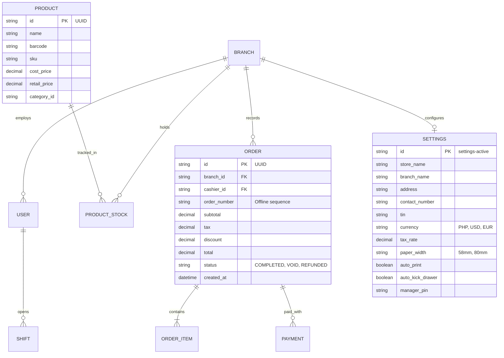

# Architecture Specification — Universal Hybrid POS

## 1. System Architecture Overview

```mermaid
flowchart TB
    subgraph Client Terminal [Tablet / Desktop / Mobile]
        direction TB
        UI[Touch UI: React + Tailwind + shadcn]
        State[Local State Store / Zustand]
        LocalDB[(Local SQLite / IndexedDB)]
        SyncQueue[(Outbox Sync Queue)]
        Hardware[ESC/POS Hardware Bridge\nBluetooth / USB / LAN]

        UI <--> State
        State <--> LocalDB
        LocalDB --> SyncQueue
        UI --> Hardware
    end

    subgraph Connectivity Gate
        OnlineCheck{Online Available?}
    end

    subgraph Cloud Infrastructure
        SyncAPI[Sync Gateway API]
        CloudDB[(Central PostgreSQL / Supabase)]
        AdminPortal[Owner Web Dashboard & Analytics]
        
        SyncAPI <--> CloudDB
        CloudDB <--> AdminPortal
    end

    SyncQueue --> Connectivity Gate
    Connectivity Gate -->|Yes - Background Sync| SyncAPI
    Connectivity Gate -->|No - Work completely offline| LocalDB
    SyncAPI -->|Delta Updates: Prices, Products| LocalDB
```

---

## 2. Technology Stack

### 2.1. Client Application (Cross-Platform Architecture)
- **Frontend Core:** **React + Vite + TypeScript**
- **UI & Styling:** Tailwind CSS + **shadcn/ui** (high tactile responsiveness, clean design, 48px+ touch targets)
- **State Management:** **Zustand** (lightweight, zero boilerplate, persistent store support)
- **Local Database (Offline Engine):** **Dexie.js (IndexedDB)**
  - Runs natively inside Android WebView (APK) and desktop browsers with zero configuration.
  - Sub-5ms query and checkout response times.
- **Cross-Platform Packaging Engine:**
  - **Android (Tablets & Sunmi/iMin POS Terminals):** **Capacitor (`@capacitor/android`)**
    - Directly compiles into a standalone **`.apk`** file.
    - Sideloadable via USB/SD card or direct download without requiring Google Play Store.
    - Full hardware access (Bluetooth Serial, Camera Barcode Scanner, Network).
  - **Desktop Registers (Windows / macOS):** Web / PWA or Tauri wrapper.

### 2.2. Hardware Communication
- **Bluetooth Thermal Printers:** Web Bluetooth API (or Capacitor Bluetooth Serial plugin).
- **Network / LAN Printers:** Direct TCP socket communication (via lightweight local agent or raw socket bridge).
- **USB & Bluetooth Handheld Barcode Scanners:** Handled as HID keyboard inputs with keystroke interval timing buffer (<50ms keystroke timing listener with automatic carriage-return interception).
- **Mobile/Tablet Camera Scanner:** WebRTC `getUserMedia` with BarcodeDetector API and `@zxing/library` pure-client fallback. Runs 100% offline with zero remote API dependencies. Supports flashlight/torch API constraints where hardware permits.
- **Audio & Haptic Feedback Bridge:** Native Web Audio API dual-frequency synthesizer (`880Hz` high beep for success, `220Hz` low buzz for missing item) paired with `navigator.vibrate` for tactile feedback without audio asset loading latency.
- **Protocol:** Raw ESC/POS byte generator (`esc-pos-encoder`).

### 2.3. Cloud & Backend (For Medium Companies & Sync)
- **Backend:** Node.js (NestJS / Fastify) or **Supabase (PostgreSQL)**
- **Authentication:** JWT with offline refresh token caching + local 4-to-6 digit PIN validation for cashiers.
- **Sync Protocol:** WebSocket or HTTP/2 Delta Pull & Push.

---

## 3. Data Sync & Conflict Resolution Architecture

### 3.1. Outbox Pattern
Every write operation produces two things in an atomic local transaction:
1. Updates the local table (e.g., `orders`, `stock_ledger`).
2. Appends an entry into `sync_queue`:
```typescript
interface SyncEvent {
  id: string; // UUIDv4
  entity: 'order' | 'product' | 'customer' | 'stock';
  action: 'CREATE' | 'UPDATE' | 'DELETE';
  payload: Record<string, any>;
  clientTimestamp: number;
  synced: boolean;
}
```

### 3.2. Id Generation
**Rule:** All entities use client-generated **UUIDv4** or **UUIDv7**. No auto-incrementing integer IDs exist in the system, preventing ID collisions between multiple offline terminals.

### 3.3. Offline Inventory Conflict Handling
- **Append-Only Stock Ledger:** Instead of modifying a mutable `stock` field directly, all inventory movements are stored as ledger records:
  - `(branch_id, product_id, delta: -1, reason: 'SALE', order_id)`
  - Total stock is computed as the sum of ledger events.
- **Graceful Negative Stock:** If two offline tablets sell the final bottle of wine, the ledger reconciles to `-1` upon sync. The system triggers an automatic reconciliation alert for the manager rather than failing or corrupting the sale.

---

## 4. Database Schema (Core Tables)


