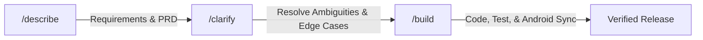

# Spec-Driven Development Workflow (SDD)

This repository implements the **Describe ➔ Clarify ➔ Build** workflow inspired by modern AI specification toolkits.



---

## The 3 Commands

### 1. `/describe <feature>`
- **Phase:** Specification & Requirements
- **Output:** Updates `docs/PRD.md` and `docs/DESIGN.md`.
- **Constraint:** Zero code written. Focuses purely on user journeys, business rules, and acceptance criteria.

### 2. `/clarify`
- **Phase:** Discovery & Alignment
- **Output:** Asks targeted multiple-choice questions on offline behavior, hardware failures, or data model edge cases.
- **Result:** Resolves all unknowns directly into `docs/PRD.md` and `docs/ARCHITECTURE.md`.

### 3. `/build`
- **Phase:** Implementation & Verification
- **Output:** Breaks work into `docs/TASKS.md`, writes code, runs `npm run build`, executes `npx cap sync`, and logs decisions into `docs/MEMORY.md`.

---

## Example Usage:

```bash
User: /describe discount coupon system with senior citizen discounts
AI:   (Updates docs/PRD.md with discount formulas, tax exemption rules, and acceptance criteria)

User: /clarify
AI:   (Asks: How should 20% senior discount interact with promotional items? Auto-exempt 12% VAT?)

User: /build
AI:   (Generates tasks in docs/TASKS.md, implements logic, runs npm run build, syncs Capacitor APK, and verifies)
```
